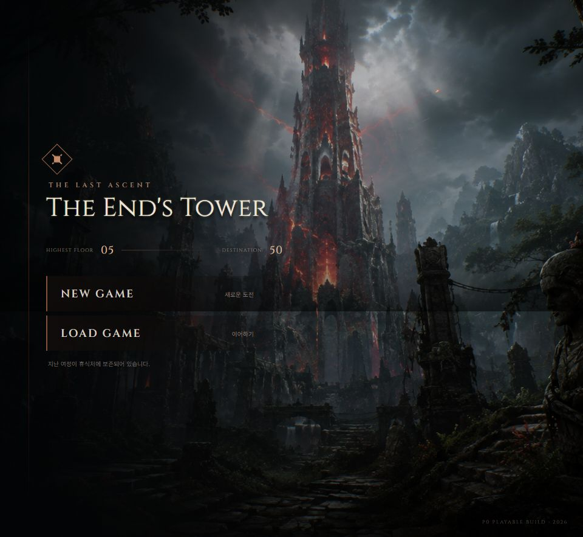
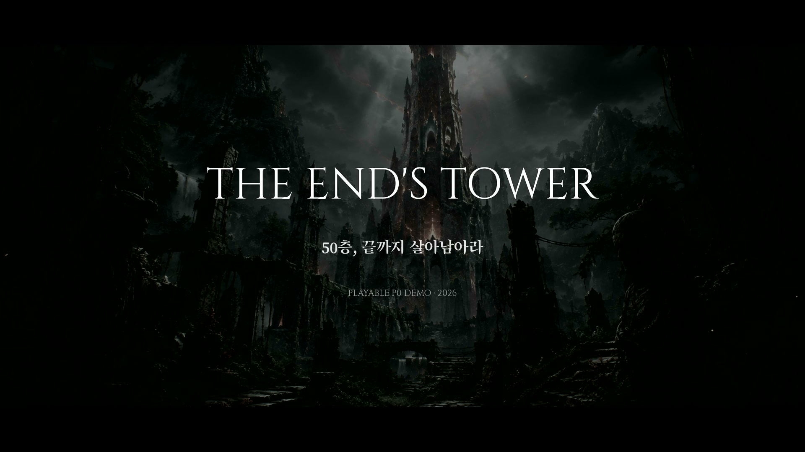
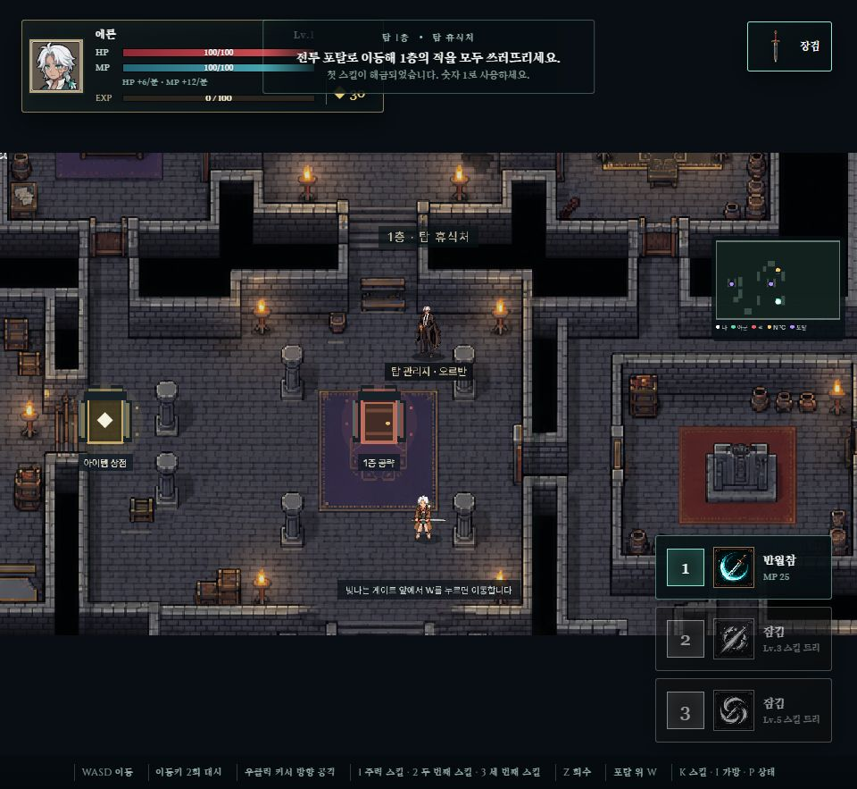

# 종말의 탑 · The End's Tower

> 50층 정상까지 살아서 오르십시오.

어둠에 잠긴 탑을 탐험하며 무기를 고르고, 전투와 성장을 반복하는
**탑 등반 액션 로그라이크 웹 게임**입니다. 현재 저장소에는 실제로 플레이할 수 있는
P0 데모와 여러 게임에서 재사용할 수 있는 엔진 독립 공통 패키지가 함께 들어 있습니다.



## 시네마틱 트레일러

[](docs/readme/trailer.mp4)

> 이미지를 누르면 18초 트레일러가 재생됩니다. 실제 플레이 장면과 게임 내 BGM·효과음으로 제작했습니다.

## 플레이

장검·단검·방패·활·지팡이 중 하나를 선택해 탑에 입장합니다. 각 층의 적을 쓰러뜨리고
포탈을 열어 다음 층으로 올라가며, 휴식처에서 회복하고 장비와 스킬을 정비합니다.



## 현재 데모에서 할 수 있는 것

- 무기 5종 로드아웃과 무기별 스킬 트리
- 시드 기반으로 재현 가능한 층 생성과 전투
- 몬스터 전투, 아이템 획득, 인벤토리와 능력치 성장
- 휴식처·상점·포탈·보스까지 이어지는 탑 진행
- 키보드와 마우스로 플레이하는 데스크톱 웹 게임
- BGM·효과음·대사·픽셀 아트가 결합된 완성형 플레이 루프

## 조작

| 입력 | 동작 |
|---|---|
| `WASD` | 이동 |
| 이동 키 2회 | 대시 |
| 마우스 오른쪽 | 커서 방향 공격 |
| `1` · `2` · `3` | 무기 스킬 |
| `Z` | 아이템 회수 |
| `W` | 포탈 위에서 이동 |
| `K` · `I` · `P` | 스킬·가방·상태 화면 |

## 로컬 실행

```bash
pnpm install
pnpm dev --filter=spire-50-demo
```

빌드와 검증:

```bash
pnpm build
pnpm test
pnpm typecheck
```

## 모노레포 구조

```text
game-monorepo/
├── apps/
│   ├── spire-50-demo/       # 종말의 탑 플레이어블 데모
│   └── sample-game/         # Phaser + Vite 예제 게임
├── packages/
│   ├── game-core/           # 시드 RNG, 점수·콤보, 수학 유틸
│   └── typescript-config/   # 공용 TypeScript 설정
├── pnpm-workspace.yaml
└── turbo.json
```

## 기술 스택

TypeScript · Phaser · Vite · Vitest · pnpm Workspaces · Turborepo

공통 로직은 Phaser에 의존하지 않는 순수 TypeScript로 유지합니다. 게임 로직에서
`Math.random()` 대신 `createRng(seed)`를 사용하므로 같은 시드의 플레이를 재현하고
테스트할 수 있습니다.

세부 게임 문서는 [`apps/spire-50-demo/README.md`](apps/spire-50-demo/README.md)를 참고하세요.
